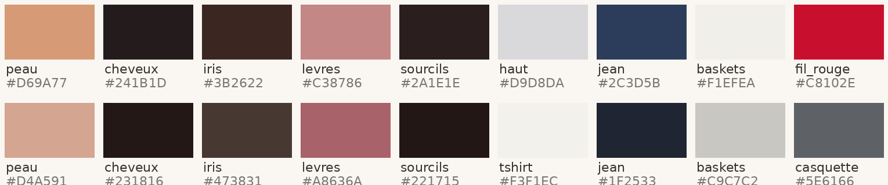
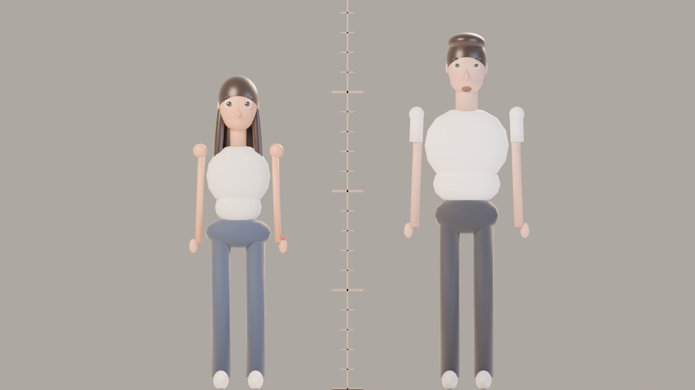
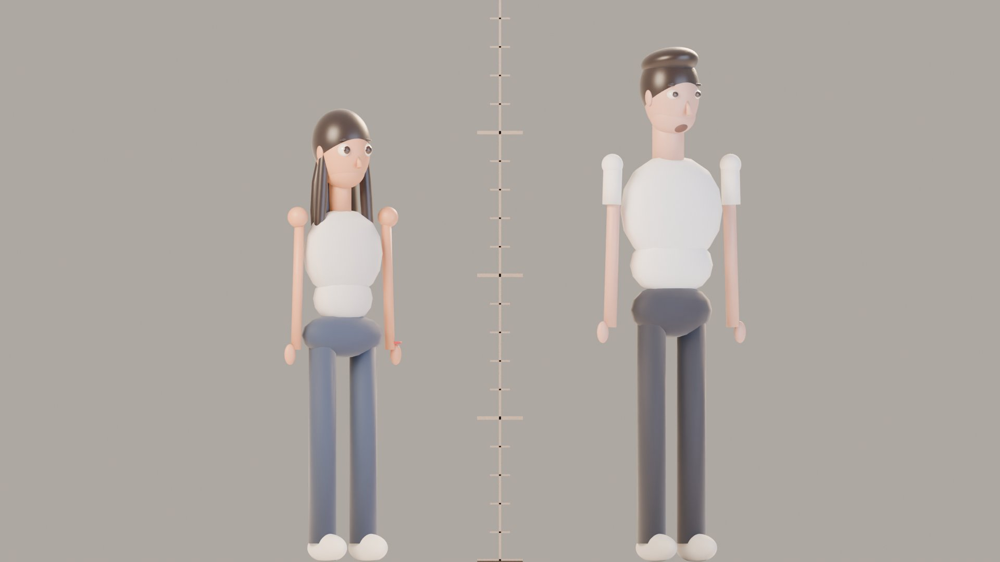
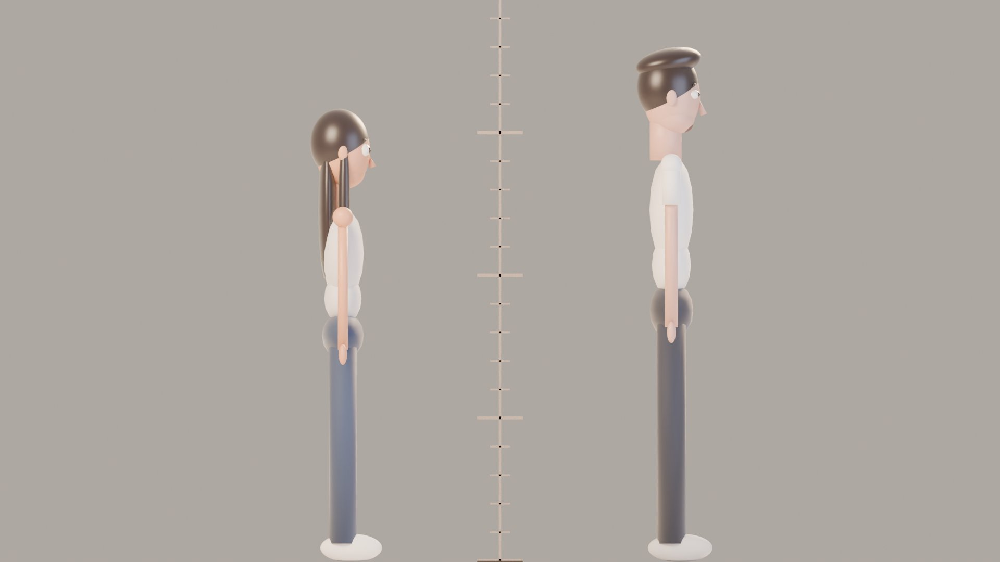
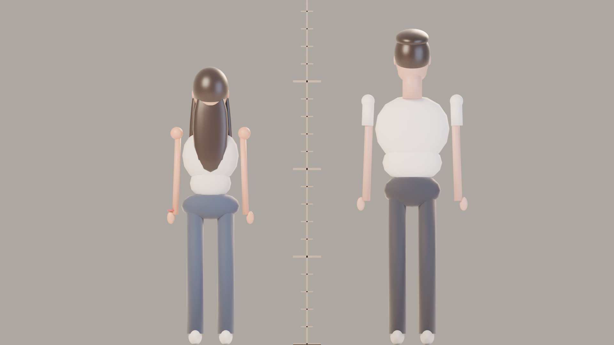

# Bible · Les personnages

> Document de référence. Toute décision sur l'apparence de Léna et Ruben est écrite ici.
> Si une scène contredit ce document, c'est la scène qui a tort.

Sources : les 3 photos fournies (porte en bois / ascenseur noir et doré / ascenseur métal).
Les couleurs ci-dessous ont été **mesurées pixel par pixel** sur la photo devant la porte
(lumière du jour, la plus neutre des trois), puis légèrement ajustées pour la 3D.

---

## 1. Ce que les photos montrent (analyse)

### Léna

| Trait | Observation sur les photos | Traduction en personnage 3D |
|---|---|---|
| Visage | Ovale doux, joues pleines, menton fin et arrondi, pommettes hautes | Tête plus large en haut, mâchoire étroite (réglage `machoire 0.62`) |
| Yeux | Bruns très foncés, en amande, légèrement étirés vers l'extérieur, regard direct | Yeux agrandis ×1,30, forme amande conservée, iris `#3B2622` presque noir avec reflet chaud |
| Sourcils | Épais, foncés, bien dessinés, arc doux | Sourcils marqués, angle léger (8°), jamais fins |
| Nez | Droit, pointe légèrement arrondie | Nez droit, petit, pointe arrondie (pas retroussé) |
| Bouche | Lèvres pleines, rose nude `#C38786` | Lèvres pleines, coins de bouche expressifs |
| Peau | Teint chaud, doré clair `#D69A77`, quelques taches de rousseur sur le nez et les pommettes (photo porte) | Peau chaude, **taches de rousseur légères conservées**, joues rosées |
| Signe distinctif | Petit grain de beauté sur la joue, près du nez (photo ascenseur métal) | À placer — **côté à confirmer** (les selfies miroir inversent la gauche et la droite) |
| Cheveux | Brun très foncé `#241B1D`, longs (sous la poitrine), lisses, raie légèrement décentrée, mèches qui encadrent le visage | **Coiffure par défaut du film (validée) : longs, lisses, brun très foncé.** Variante « boucles » (photo ascenseur noir) seulement pour une occasion précise, sur votre demande |
| Silhouette | Fine, taille marquée | 6,4 têtes de haut (stylisé) |
| Accessoires | **Bracelet fil rouge** (2 photos), fine chaînette, ongles amande nude | Le fil rouge est porté dans tout le film (voir direction artistique) |
| Style | Minimaliste : débardeurs côtelés gris / crème, col montant, jean large brut, pantalon daim camel, baskets blanches | Garde-robe neutre et lumineuse |

### Ruben

| Trait | Observation sur les photos | Traduction en personnage 3D |
|---|---|---|
| Visage | Allongé, mâchoire définie, menton marqué | Tête plus haute qu'elle n'est large (`tete_larg 0.76`) |
| Yeux | Marron `#473831`, paupières un peu lourdes, regard calme et pince-sans-rire | Paupières mi-closes au repos (`paupiere 0.80`) : c'est sa « signature » de calme |
| Sourcils | Épais, droits, foncés, un peu froncés | Sourcils épais (×1,7), presque horizontaux |
| Nez | Long et droit | Nez plus long que Léna (×1,25) |
| Bouche | Lèvres pleines | Lèvres pleines |
| Pilosité | Léger duvet : moustache fine, menton, début de joues | Ombre de barbe peinte en texture, pas de barbe en volume |
| Peau | Teint clair chaud, légèrement rosé `#D4A591` | Un ton plus clair et plus rosé que Léna |
| Cheveux | Brun très foncé `#231816`, courts sur les côtés, volume ondulé sur le dessus, coiffés vers l'arrière | Coiffure principale. Variante « mouillés plaqués » (photo ascenseur métal) |
| Silhouette | Grand, épaules plus larges | 6,9 têtes de haut |
| Accessoires | Casquette trucker grise (sans le logo : on n'affiche aucune marque), bracelet foncé au poignet | Casquette = accessoire optionnel (scènes extérieures) |
| Style | T-shirts blancs, manches longues raglan écru, pantalon lin clair, jean foncé | Garde-robe blanche / écrue |

### Le détail qui vaut de l'or

Sur **les trois photos**, l'un des deux (ou les deux) fait **la moue « bisou »**.
Ce sera une expression officielle du film pour chacun, et un gag récurrent possible
(« la moue selfie »). → *À valider par Léna.*

---

## 2. Règles de stylisation (comment on passe du réel au film d'animation)

1. **On garde ce qui fait la ressemblance**, on simplifie le reste.
   Ressemblance de Léna = yeux en amande foncés + sourcils épais + joues pleines + longs cheveux lisses très foncés + taches de rousseur.
   Ressemblance de Ruben = visage allongé + paupières lourdes + sourcils droits épais + long nez droit + duvet + volume coiffé en arrière.
2. **On agrandit les yeux** (Léna ×1,30, Ruben ×1,15) : c'est ce qui donne le côté « film d'animation » et porte les émotions. Ruben moins que Léna, pour garder son air calme.
3. **On réduit le nombre de têtes** (réel ≈ 7,5 → 6,4 et 6,9) : tête un peu plus grande = visage plus lisible.
4. **Peau** : lisse mais pas plastique (diffusion sous la surface « SSS » à 0,25), joues et nez légèrement rosés.
5. **Cheveux** : en mèches regroupées (« clumps »), jamais un casque. Reflet doux.
6. **Interdit** : changer la couleur des yeux, éclaircir les cheveux, affiner le nez de Ruben, supprimer les taches de rousseur de Léna, ajouter du maquillage fort.

---

## 3. Proportions (maquettes de travail)

> ⚠️ Ces images sont des **maquettes de proportions** fabriquées et rendues par le script
> `blender/01_atelier_personnages.py`. Ce ne sont **pas** les personnages finaux :
> elles fixent les tailles, les largeurs et les volumes. Elles serviront de doublures
> pour le story-board 3D. Les vrais personnages seront modelés par-dessus (étapes 2 à 5).

| Face | Trois-quarts | Profil | Dos |
|---|---|---|---|
|  |  |  |  |

| Mesure | Léna | Ruben |
|---|---|---|
| Taille | **1,55 m** (confirmé) | **1,75 m** (confirmé) |
| Hauteur en têtes | 6,4 | 6,9 |
| Largeur d'épaules | 1,55 tête | 1,95 tête |
| Largeur de hanches | 1,50 tête | 1,40 tête |
| Entrejambe | 48,5 % de la taille | 47,5 % de la taille |
| Taille des yeux | ×1,30 | ×1,15 |
| Écart de taille entre eux | **20 cm** : le haut de la tête de Léna arrive au niveau de la bouche de Ruben. Pour se regarder dans les yeux, elle lève la tête et il la baisse : à utiliser dans la mise en scène (bisous, « boop » sur le nez) | |

---

## 4. Planche d'expressions (liste officielle)

Chaque expression sera enregistrée **une seule fois** dans la bibliothèque de poses du
personnage, avec ce nom exact, puis réutilisée dans toutes les scènes.

| Nom de la pose | Léna | Ruben |
|---|---|---|
| `neutre` | Regard direct, lèvres closes, léger sourire en coin (photo porte) | Paupières mi-closes, bouche détendue |
| `moue_bisou` | Moue, sourcils relevés, yeux de côté (photo ascenseur métal) | Moue exagérée, menton levé (photos 1 et 2) |
| `fou_rire` | Yeux plissés, tête en arrière, mains devant la bouche | Rire silencieux, épaules qui tremblent, yeux fermés |
| `taquine` | Sourcil levé, sourire en coin, menton baissé | Demi-sourire, un seul sourcil levé, regard en biais |
| `tendresse` | Yeux brillants, sourire doux, tête inclinée | Regard posé sur elle, petit sourire, sourcils détendus |
| `larmes` (début du film) | Yeux humides, lèvre qui tremble, regard bas | — |
| `surprise` (Marrakech) | Bouche ouverte, mains sur le visage, yeux immenses | Sourire fier, regard qui guette sa réaction |
| `attentionne` | — | Sourcils légèrement relevés au centre, tête penchée vers elle |
| `boude` | Joues gonflées, bras croisés | Faux air vexé, lèvres pincées |

### Gestes signatures (à placer naturellement dans le film)
- **Léna serre les joues de Ruben** (deux mains, il se laisse faire, air résigné et heureux).
- **Ruben touche le nez de Léna** (index, petit « boop », souvent pour clore une taquinerie).

---

## 5. Garde-robe (costumes)

| Code | Léna | Ruben | Source |
|---|---|---|---|
| `C1_ville` | Débardeur côtelé gris clair, jean brut large, baskets blanches, fil rouge | T-shirt blanc épais, jean foncé, baskets grises, casquette grise (option) | Photo porte |
| `C2_soir` | Haut col montant écru sans manches, pantalon daim camel, cheveux lisses (boucles seulement sur demande) | Pull fin écru manches raglan, pantalon lin clair | Photo ascenseur noir |
| `C3_ete` | Haut col montant crème ajusté, cheveux lisses | Manches longues blanc cassé, cheveux mouillés plaqués | Photo ascenseur métal |
| Autres | À définir chapitre par chapitre (anniversaire, restaurant, Marrakech, Milan…) avec vos photos de ces moments | | |

---

## 6. Points à confirmer par Léna
- [x] Tailles réelles : Léna 1,55 m, Ruben 1,75 m
- [x] Coiffure par défaut de Léna : longs cheveux lisses, brun très foncé
- [ ] Côté du grain de beauté de Léna
- [ ] « La moue selfie » comme expression officielle et gag récurrent : oui / non
- [ ] Le motif magique du « fil rouge » (voir direction artistique) : oui / non
- [ ] Votre ordinateur (PC ou Mac, mémoire vive, carte graphique)
